### Machine Learning AdaBoost

> Warning: 
> > There is lot of mistake with respect to the visual representaion and the example, so just use this for reference, not a proper note

The general idea behind boosting methods is to train predictors sequentially, each trying to correct its predecessor. The two most commonly used boosting algorithms are AdaBoost and Gradient Boosting. In the proceeding article, we’ll cover AdaBoost. At a high level, AdaBoost is similar to Random Forest in that they both tally up the predictions made by each decision trees within the forest to decide on the final classification. There are however, some subtle differences. For instance, in AdaBoost, the decision trees have a depth of 1 (i.e. 2 leaves). In addition, the predictions made by each decision tree have varying impact on the final prediction made by the model.
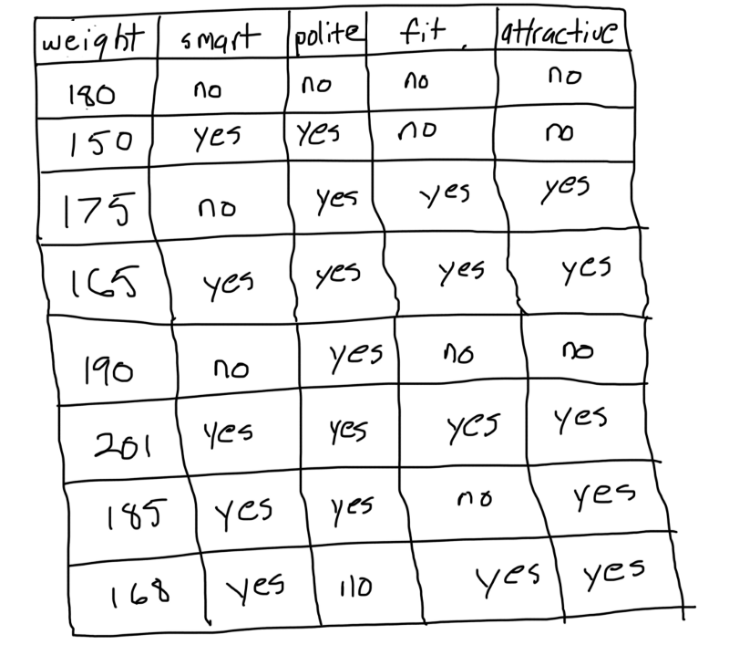
### Step 1: Initialize the sample weights

In first step of AdaBoost each sample is associated with a weight that indicates how important it is with regards to the classification. Initially, all the samples have identical weights (1 divided by the total number of samples).
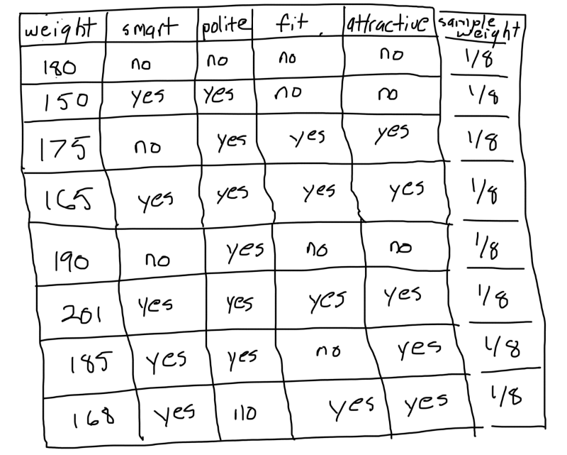 
### Step 2: Build a decision tree with each feature, classify the data and evaluate the result

Next, for each feature, we build a decision tree with a depth of 1. Then, we use every decision tree to classify the data. Afterwards, we compare the predictions made by each tree with the actual labels in the training set. The feature and corresponding tree that did the best job of classifying the training samples becomes the next tree in the forest.

For example, assume that we built a tree that classifies people as attractive if they’re smart and unattractive if they’re not.

The decision tree incorrectly classified 1 person as being attractive based off the fact that they were smart. We repeat the process for all trees and select the one with the smallest number of incorrect predictions.
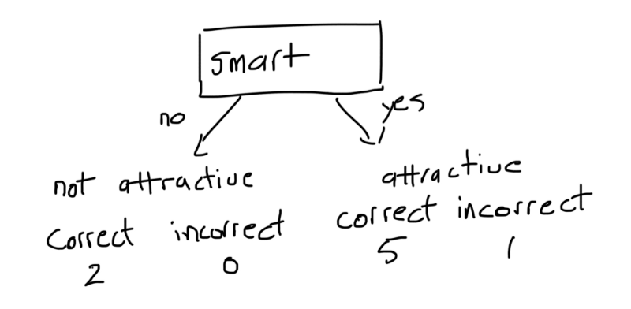 
### Step 3: Calculate the significance of the tree in the final classification

Once we have decided on a decision tree. We use the proceeding formula to calculate the amount of say the it has in the final classification.
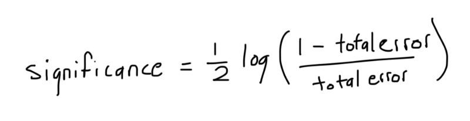 
Where the total error is the sum of the weights of the incorrectly classified samples.
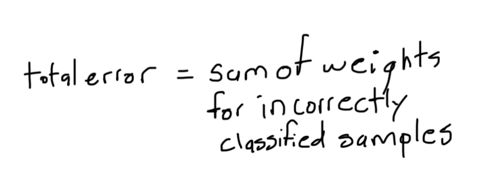 
Going back to our example, total error would be equal to the following.
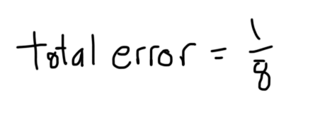 
By plugging the error into our formula, we get:
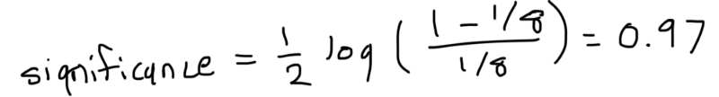 
### Step 4: Update the sample weights so that the next decision tree will take the errors made by the preceding decision tree into account

We look at the samples that the current tree classified incorrectly and increase their associated weights using the following formula.
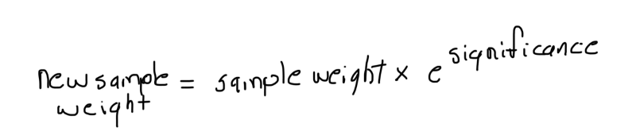 
There’s nothing fancy going on here. We raise e to the power of the significance computed in the previous step because we want the new sample weight to grow exponentially.
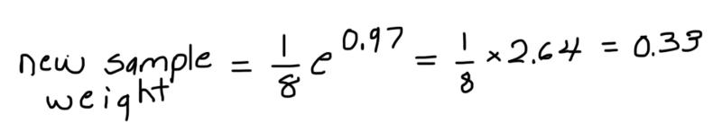 
Then, we look at the samples that the tree classified correctly and decrease their associated weights using the following formula.
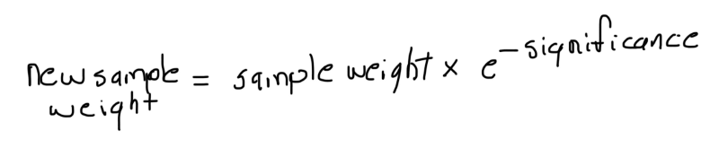 
The equation is the same as before only this time, we raise e to the power of a negative exponent.
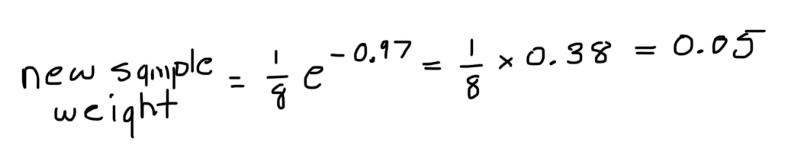 
The main take away here is that the samples which the previous stump incorrectly classified should be associated with larger sample weights and the ones it classified correctly should be associated with smaller sample weights.

Notice how if we summed all the sample weights, we’d get a number that is smaller than 1. Thus, we normalize the new sample weights so that they add up to 1.
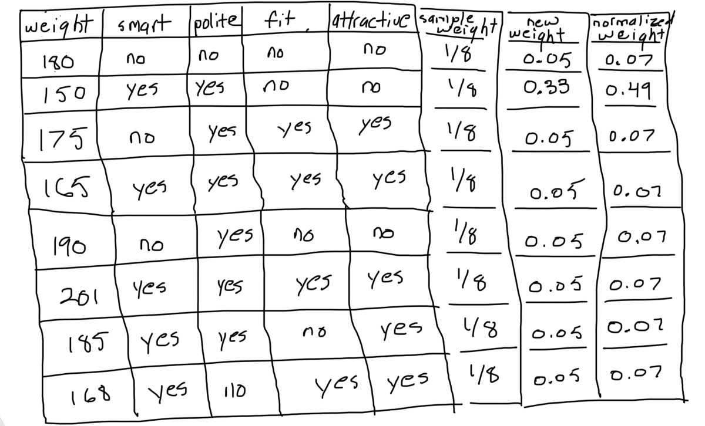 
### Step 5: Form a new dataset

We start by making a new and empty dataset that is the same size as the original. Then, imagine a roulette table where each pocket corresponds to a sample weight. We select numbers between 0 and 1 at random. The location where each number falls determines which sample we place in the new dataset.
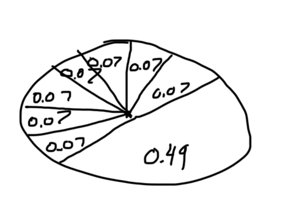 
Since the samples that were incorrectly classified have higher weights in relation to the others, the likelihood that the random number falls under their slice of the distribution is greater. Therefore, the new dataset will have a tendency to contain multiple copies of the samples that were misclassified by the previous tree. As a result, when we go back to the step where we evaluate the predictions made by each decision tree, the one with the highest score will have correctly classified the samples the previous tree misclassified.
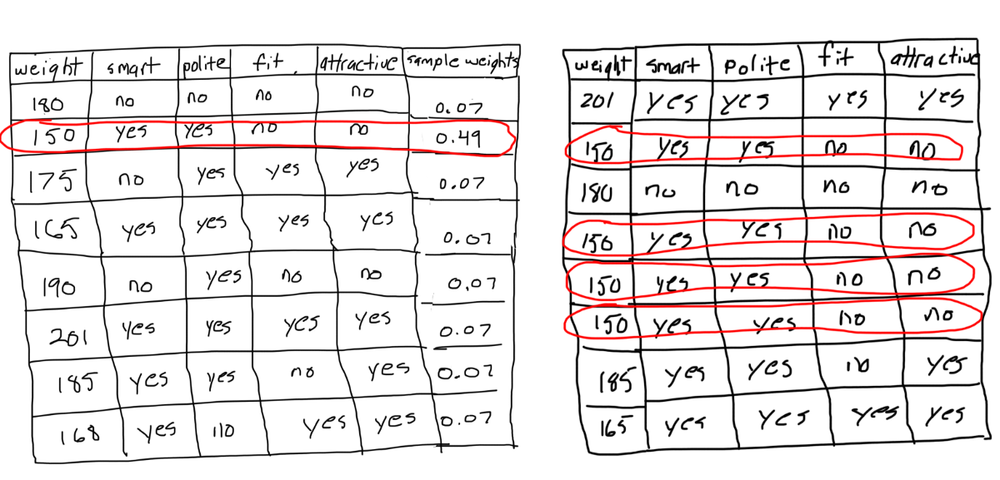 
### Step 6: Repeat steps 2 through 5 until the number of iterations equals the number specified by the hyperparameter (i.e. number of estimators)
### Step 7: Use the forest of decision trees to make predictions on data outside of the training set

The AdaBoost model makes predictions by having each tree in the forest classify the sample. Then, we split the trees into groups according to their decisions. For each group, we add up the significance of every tree inside the group. The final classification made by the forest as a whole is determined by the group with the largest sum.
